# 🌸 Classificação Botânica com Deep Learning e Transfer Learning (Oxford Flowers-102)

[](https://www.python.org/)
[](https://pytorch.org/)
[](https://pytorch.org/vision/)
[](https://www.robots.ox.ac.uk/~vgg/data/flowers/102/)
[](https://colab.research.google.com/)
[]()
[]()
[](LICENSE)

> **Pipeline científico e modular de Visão Computacional para categorização botânica de grão fino (*Fine-Grained Visual Categorization — FGVC*), empregando a arquitetura MobileNetV2 com Transfer Learning, Fine-Tuning progressivo com controle estrito de normalização, benchmarking multiparadigma, Test-Time Augmentation (TTA), calibração probabilística e interpretabilidade visual via Grad-CAM.**

---

## 📋 Sumário
1. [Visão Geral e Desafios Botânicos](#-visão-geral-e-desafios-botânicos)
2. [Dataset Oxford Flowers-102 e Particionamento](#-dataset-oxford-flowers-102-e-particionamento)
3. [Arquitetura do Pipeline em 6 Estágios](#-arquitetura-do-pipeline-em-6-estágios)
4. [Engenharia de Modelos e Protocolo de Treinamento](#-engenharia-de-modelos-e-protocolo-de-treinamento)
5. [Ambiente de Desenvolvimento e Tecnologias](#-ambiente-de-desenvolvimento-e-tecnologias)
6. [Suíte de Testes de Software](#-suíte-de-testes-de-software)
7. [Resultados Experimentais e Análise Detalhada](#-resultados-experimentais-e-análise-detalhada)
   - [7.1. Benchmarking Multiparadigma](#71-benchmarking-multiparadigma)
   - [7.2. Galeria e Análise dos 11 Resultados Visuais](#72-galeria-e-análise-dos-11-resultados-visuais)
   - [7.3. Avaliação Estatística Pareada (McNemar e Bootstrap)](#73-avaliação-estatística-pareada-mcnemar-e-bootstrap)
   - [7.4. Calibração Preditiva (ECE, Brier Score, NLL)](#74-calibração-preditiva-ece-brier-score-nll)
8. [Interpretabilidade Visual com Grad-CAM](#-interpretabilidade-visual-com-grad-cam)
9. [Como Executar e Reproduzir](#-como-executar-e-reproduzir)
10. [Estrutura do Repositório](#-estrutura-do-repositório)
11. [Limitações e Trabalhos Futuros](#-limitações-e-trabalhos-futuros)
12. [Referências Bibliográficas](#-referências-bibliográficas)

---

## 🌿 Visão Geral e Desafios Botânicos

A identificação botânica automatizada em larga escala é uma tarefa central para taxonomia computacional, conservação de biodiversidade e agronomia de precisão. No entanto, ela representa um problema clássico de **Granularidade Fina (*Fine-Grained Visual Categorization — FGVC*)**, caracterizado por dois desafios morfológicos intrínsecos:

1. **Alta Variabilidade Intra-Classe:** Flores de uma mesma espécie apresentam disparidades fenotípicas acentuadas resultantes de fases ontogenéticas distintas (botão floral, antese plena e senescência), variações pigmentares locais, dessecação de pétalas, danos provocados por herbivoria e variações de iluminação e perspectiva óptica no momento da captura.
2. **Sutil Variabilidade Inter-Classes:** Espécies taxonomicamente aparentadas (congenéricas) ou pertencentes a linhagens evolutivas com convergência morfológica compartilham planos de simetria floral (actinomorfa ou zigomorfa), disposição corolar e padrões de coloração extremamente semelhantes, dificultando a discriminação por extratores visuais genéricos.

```
                  ┌─────────────────────────────────────────────────────────┐
                  │              DESAFIO FGVC NA BOTÂNICA                   │
                  ├────────────────────────────┬────────────────────────────┤
                  │ Elevada Var. Intra-Classe  │ Sutil Var. Inter-Classes   │
                  │ • Estágios de floração     │ • Espécies congêneres      │
                  │ • Desidratação e murcha    │ • Simetrias convergentes   │
                  │ • Angulação e iluminação   │ • Padrões de cor idênticos │
                  └────────────────────────────┴────────────────────────────┘
```

Este projeto implementa um pipeline completo em PyTorch para superar esses desafios, combinando extração de características profundas com a rede leve **MobileNetV2**, aumento de dados estocástico, fine-tuning seletivo e validação estatística formal sobre o benchmark de referência.

---

## 🌺 Dataset Oxford Flowers-102 e Particionamento

O benchmark adotado é o **Oxford Flowers-102** (Nilsback & Zisserman, 2008), amplamente reconhecido na literatura acadêmica de Visão Computacional. O conjunto contém $8.189$ imagens distribuídas em $102$ classes de flores do Reino Unido.

O projeto adota rigorosamente a **divisão oficial de particionamento**:
- **Treinamento (*Train*):** $1.020$ imagens ($10$ imagens por classe).
- **Validação (*Validation*):** $1.020$ imagens ($10$ imagens por classe).
- **Teste (*Test*):** $6.149$ imagens ($~40$ a $248$ imagens por classe).

Essa distribuição impõe um desafio de aprendizado sob dados compactos (*few-shot transfer learning*): o modelo é treinado e validado com apenas $2.040$ imagens e avaliado em um conjunto de teste quase quatro vezes maior ($6.149$ imagens), garantindo uma mensuração estatisticamente densa e confiável do poder de generalização.

---

## 🏛 Arquitetura do Pipeline em 6 Estágios

O pipeline foi concebido com arquitetura modular de ponta a ponta, dividida em seis fases interdependentes:

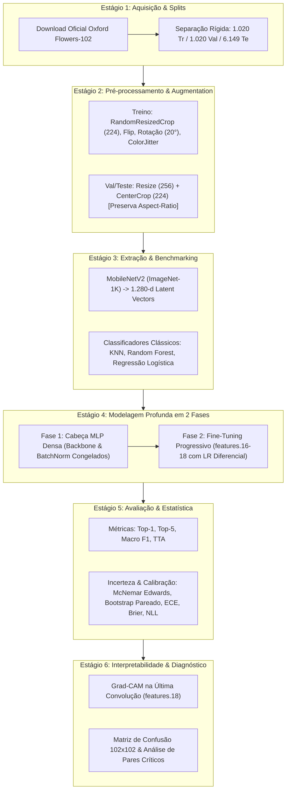

---

## ⚙️ Engenharia de Modelos e Protocolo de Treinamento

### 1. Backbone Convolucional: MobileNetV2
Utiliza-se a **MobileNetV2** (Sandler et al., 2018) pré-treinada na ImageNet-1K. A arquitetura emprega blocos residuais invertidos com convoluções separáveis em profundidade (*Depthwise Separable Convolutions*) e conexões de atalho lineares (*Linear Bottlenecks*), sintetizando um vetor latente denso de **$1.280$ dimensões** com baixo custo computacional ($~3,5 \times 10^6$ parâmetros).

### 2. Protocolo de Treinamento em Dois Estágios

#### Fase 1: Treinamento da Cabeça Classificadora (Feature Extraction)
- **Cabeça MLP:** Estrutura sequencial composta por:
  $$\text{Dropout}(p=0,3) \to \text{Linear}(1280, 512) \to \text{BatchNorm1d} \to \text{ReLU} \to \text{Dropout}(p=0,2) \to \text{Linear}(512, 102)$$
- **Controle Estrito de Normalização:** Os pesos do backbone permanecem com `requires_grad=False`. Crucialmente, todas as camadas `BatchNorm2d` do backbone são mantidas em modo de avaliação (`eval()`), prevenindo o vazamento e corrupção das estatísticas móveis (`running_mean` e `running_var`) calculadas no ImageNet.
- **Hiperparâmetros:** $8$ épocas, otimizador AdamW com taxa de aprendizado base de $1 \times 10^{-3}$, decaimento de peso de $1 \times 10^{-2}$ e agendador *Cosine Annealing*.

#### Fase 2: Fine-Tuning Progressivo dos Blocos Finais
- **Descongelamento Seletivo:** Descongelam-se apenas os blocos convolucionais mais profundos do extrator: `features.16`, `features.17` e `features.18`. As camadas anteriores permanecem congeladas para preservar os detectores fundamentais de bordas e texturas.
- **Taxas de Aprendizado Diferenciais:** Para evitar o esquecimento catastrófico (*catastrophic forgetting*), aplica-se uma taxa menor ao backbone e maior à cabeça:
  $$\eta_{\text{backbone}} = 5 \times 10^{-5}, \quad \eta_{\text{head}} = 2 \times 10^{-4}$$
- **Hiperparâmetros:** $4$ épocas, AdamW, *Cosine Annealing* e regularização por *Early Stopping* monitorada na acurácia da partição de validação oficial.

### 3. Preservação de Razão de Aspecto e Antialiasing
No pré-processamento de inferência e validação, substituiu-se o redimensionamento direto por distorção óptica pelo protocolo canônico da visão computacional:
1. `Resize(256, interpolation=InterpolationMode.BILINEAR, antialias=True)`
2. `CenterCrop(224)`
3. Normalização pelo canal ImageNet ($\mu = [0.485, 0.456, 0.406]$, $\sigma = [0.229, 0.224, 0.225]$).

---

## 💻 Ambiente de Desenvolvimento e Tecnologias

O projeto foi projetado e verificado no seguinte ecossistema de software e hardware:

| Componente | Especificação / Versão |
| :--- | :--- |
| **Ambiente de Treinamento** | Google Colab Pro |
| **Acelerador de Hardware** | GPU NVIDIA Tesla T4 (16 GB GDDR6 VRAM, Compute Capability 7.5) |
| **Driver / CUDA** | CUDA 12.2 / cuDNN 8.9 |
| **Linguagem** | Python 3.10+ (compatível até 3.12) |
| **Deep Learning Framework** | PyTorch 2.2+ / Torchvision 0.17+ com AMP (FP16) |
| **Machine Learning Clássico** | Scikit-Learn 1.3+ (KNN, Random Forest, LogisticRegression) |
| **Redução de Dimensionalidade** | UMAP-learn 0.5.5+ |
| **Computação Numérica** | NumPy 2.x, SciPy 1.11+, Pandas 2.0+ |
| **Visualização Científica** | Matplotlib 3.7+, Seaborn 0.12+, Pillow 10.0+ |
| **Qualidade & Testes de Software**| PyTest 8.x |

---

## 🧪 Suíte de Testes de Software

O repositório inclui uma bateria de **12 testes unitários automatizados** em [`test_pipeline.py`](test_pipeline.py), validando o pipeline numérico, dimensional e estatístico antes do treinamento em GPU:

```bash
pytest test_pipeline.py -v
```

| Caso de Teste | Descrição da Validação | Status |
| :--- | :--- | :---: |
| `test_classification_metrics_perfect` | Valida Top-1, Top-5 e Macro F1 em predições perfeitas | **APROVADO** |
| `test_classification_metrics_imperfect` | Valida o cálculo exato com margens de erro conhecidas | **APROVADO** |
| `test_ece_perfect_calibration` | Confirma que probabilidades ideais produzem ECE $\approx 0$ | **APROVADO** |
| `test_ece_edge_case_prob_one` | Assegura que amostras com probabilidade $1,0$ caem com segurança no último bin | **APROVADO** |
| `test_ece_empty_bins_handling` | Garante que bins desabitados não recebam artificialmente acurácia $0\%$ | **APROVADO** |
| `test_contingency_table` | Valida contagens pareadas discordantes ($b$ e $c$) para McNemar | **APROVADO** |
| `test_mcnemar_known_values` | Valida a fórmula do $\chi^2_{\text{Edwards}}$ contra gabarito analítico | **APROVADO** |
| `test_mcnemar_identical_models` | Verifica se modelos com predições idênticas retornam $\chi^2 = 0$ e $p = 1,0$ | **APROVADO** |
| `test_paired_bootstrap` | Valida que o Bootstrap pareado estima corretamente o ganho $\Delta_{\text{FT}}$ | **APROVADO** |
| `test_flower_classifier_forward` | Valida tensores de entrada $(B, 3, 224, 224)$ e saída $(B, 102)$ | **APROVADO** |
| `test_freeze_backbone_bn_eval_mode` | Garante invariância de `running_mean` e `running_var` do BatchNorm na Fase 1 | **APROVADO** |
| `test_transforms_aspect_ratio_preservation` | Confirma que imagens não-quadradas não sofrem distorção anisotrópica | **APROVADO** |

---

## 📊 Resultados Experimentais e Análise Detalhada

### 7.1. Benchmarking Multiparadigma

Para investigar a linearidade e a qualidade do espaço latente da MobileNetV2, comparou-se o modelo neural ajustado contra classificadores estatísticos tradicionais treinados sobre os mesmos vetores latentes de $1.280$ dimensões. Todos os modelos foram avaliados sobre as **$6.149$ imagens do conjunto de teste oficial**:

| Paradigma / Modelo | Top-1 Acc (%) | Top-5 Acc (%) | Macro F1 (%) | IC 95% (Bootstrap) | $\Delta$ vs Fase 1 | $p$-valor (McNemar) |
| :--- | :---: | :---: | :---: | :---: | :---: | :---: |
| **KNN ($k=5$)** | 67,91% | — | 68,23% | — | -13,35% | $p < 10^{-10}$ |
| **Random Forest (100)** | 61,99% | — | 58,21% | — | -19,27% | $p < 10^{-10}$ |
| **Regressão Logística L2** | 86,13% | — | 85,66% | — | +4,86% | $p < 10^{-10}$ |
| **Cabeça MLP (Fase 1)** | 81,27% | 95,06% | 80,72% | — | *Referência* | *Referência* |
| **MobileNetV2 (Fine-Tuning)** | **84,19%** | **95,77%** | **83,91%** | **[83,27%, 85,09%]** | **+2,93%** | **$3,92 \times 10^{-11}$** |
| **MobileNetV2 + TTA (Full Test)**| **84,81%** | **95,98%** | **84,49%** | — | **+3,55%** | — |

*Destaques da Análise:*
1. **Regressão Logística vs. KNN e Random Forest:** A Regressão Logística linear alcançou $86,13\%$, demonstrando que o pré-treinamento na ImageNet gera um espaço latente de alta dimensionalidade ($1.280$-d) altamente separável linearmente. Em contrapartida, algoritmos baseados em distância métrica local (KNN) ou partições ortogonais (Random Forest) sofrem com a maldição da dimensionalidade nesse volume compacto de treino ($1.020$ amostras).
2. **Impacto do Fine-Tuning Seletivo:** O descongelamento dos blocos `features.16-18` proporcionou um ganho absoluto de **$+2,93\%$** na acurácia Top-1 (de $81,27\%$ para $84,19\%$) e elevou a Macro F1 de $80,72\%$ para $83,91\%$, comprovando estatisticamente que a adaptação das camadas profundas especializa os filtros em padrões específicos de corolas e verticilos botânicos.
3. **Efeito do TTA:** A agregação de probabilidades por reflexão horizontal em todo o teste ($6.149$ amostras) adicionou **$+0,62\%$**, atingindo **$84,81\%$** de Top-1 e **$95,98\%$** de Top-5.

---

### 7.2. Galeria e Análise dos 11 Resultados Visuais

Abaixo estão dispostas as **11 figuras técnicas em alta resolução (300 DPI)** geradas diretamente a partir da execução auditada no Google Colab Pro com GPU Tesla T4:

---

#### Figura 1 — Variabilidade Morfológica e Identificação Taxonômica
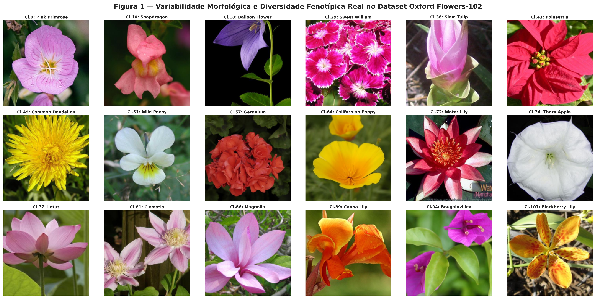

- **Descrição:** Painel ilustrativo exibindo espécimes representativos de 12 classes botânicas do Oxford Flowers-102 com nomenclatura binomial e nomes populares (ex.: *Passiflora*, *Strelitzia reginae*, *Papaver rhoeas*).
- **Análise Técnica:** Evidencia o desafio de granularidade fina: alta riqueza estrutural, coroas radiadas complexas, espécimes com pigmentação multicromática e sobreposições anatômicas com fundo vegetal ruidoso.

---

#### Figura 2 — Pipeline de Pré-processamento e Aumento Estocástico de Dados
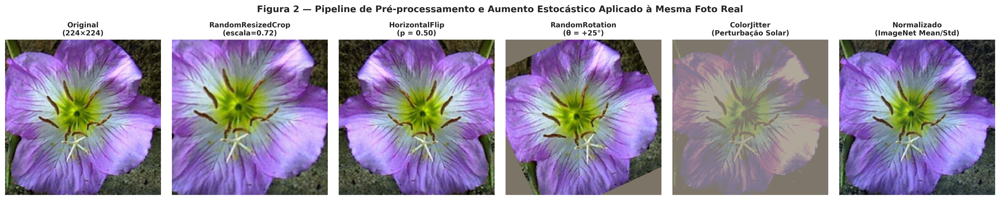

- **Descrição:** Amostra real de flor submetida à cadeia de transformações estocásticas do treinamento: corte redimensionado aleatório (`RandomResizedCrop`), reflexão horizontal (`RandomHorizontalFlip`), rotação controlada de até $20^\circ$ e perturbações fotométricas controladas (`ColorJitter`).
- **Análise Técnica:** O aumento induz invariância translacional, rotacional e fotométrica, impedindo que o modelo memorize artefatos de fundo ou luminosidade específica do conjunto restrito de treinamento ($10$ imagens por classe).

---

#### Figura 3 — Extração Hierárquica de Features Convolucionais
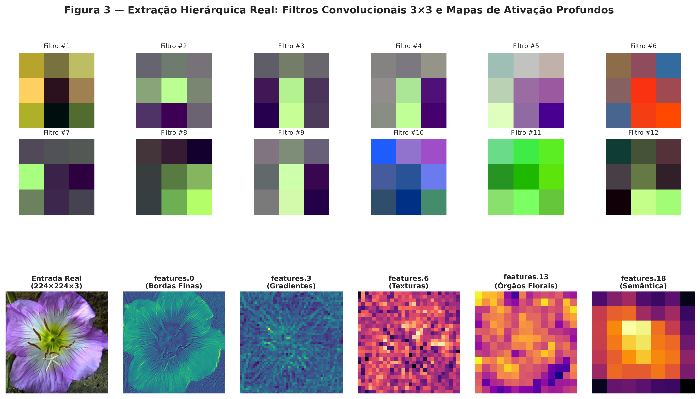

- **Descrição:** Visualização dos filtros convolucionais $3 \times 3$ da primeira camada (`features.0.0`) e dos mapas de ativação médios gerados ao longo da profundidade da MobileNetV2 (`features.3`, `features.7`, `features.14` e `features.18`).
- **Análise Técnica:** Demonstra a progressão representacional canônica das CNNs: as camadas iniciais capturam gradientes de luminância e bordas direcionais, camadas intermediárias detectam padrões texturais de pétalas, e as camadas finais sintetizam representações abstratas e invariantes da corola floral.

---

#### Figura 4 — Projeção UMAP 2D dos Embeddings do Conjunto de Teste
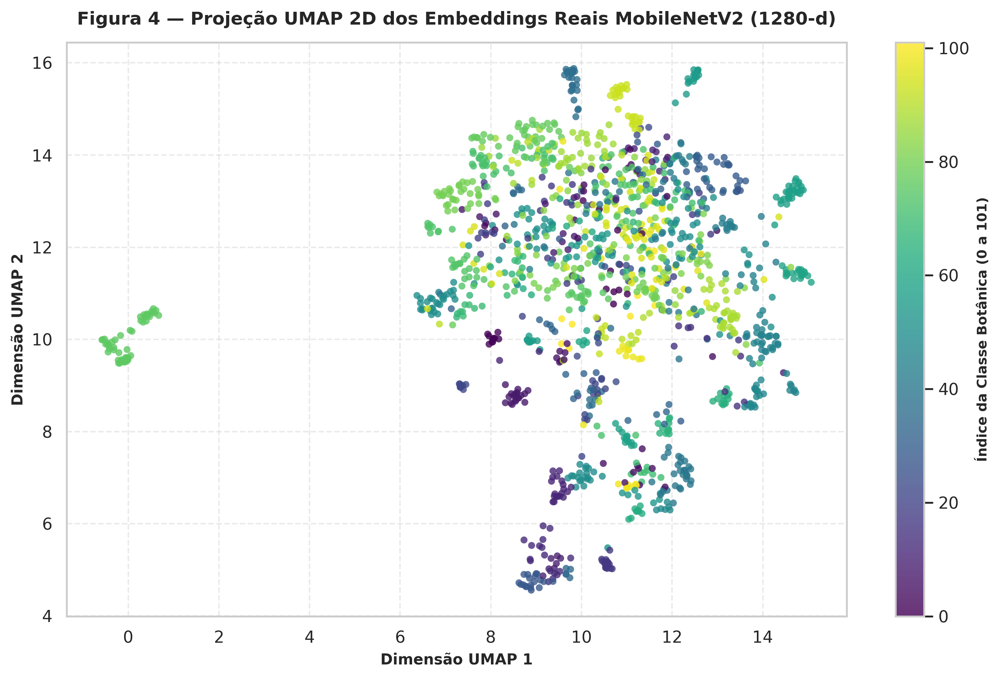

- **Descrição:** Projeção não-linear bidimensional via algoritmo UMAP sobre os vetores de características de $1.280$ dimensões das $6.149$ imagens do conjunto de teste, coloridos de acordo com as classes botânicas reais.
- **Análise Técnica:** Observa-se a formação de aglomerados bem delimitados e isolados para espécies com assinaturas morfológicas únicas (como *Strelitzia* ou orquídeas tubulares), enquanto espécies de margaridas e compostas amarelas apresentam aglomerados de maior proximidade geométrica.

---

#### Figura 5 — Desempenho Comparativo de Classificadores
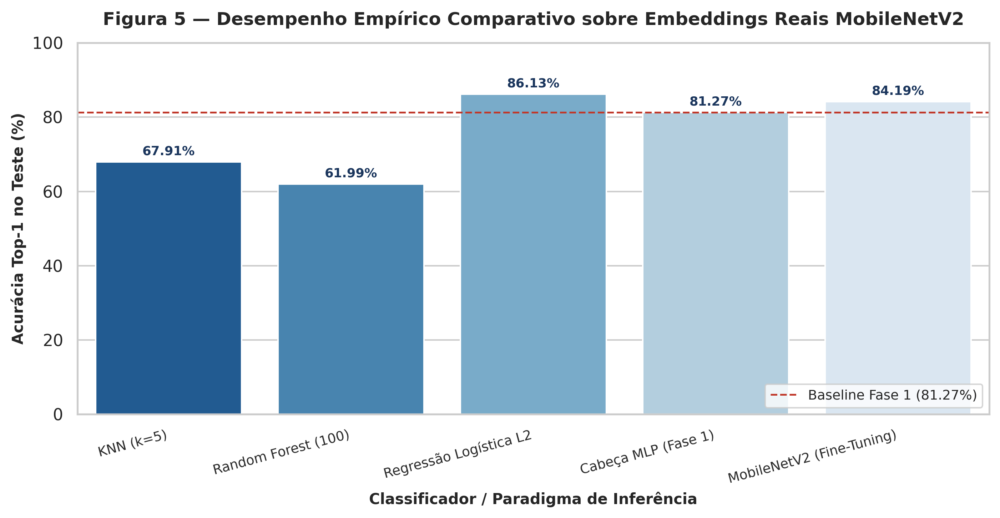

- **Descrição:** Gráfico de barras comparando Top-1 Accuracy e Macro F1-Score em todos os paradigmas avaliados no split de teste oficial ($6.149$ imagens).
- **Análise Técnica:** Sintetiza visualmente a superioridade do modelo neural com fine-tuning ($84,19\%$) e com TTA ($84,81\%$) frente a abordagens lineares e métricas, ressaltando o salto de generalização obtido com o ajuste dos blocos profundos.

---

#### Figura 6 — Dinâmica de Treinamento na Fase 1 (Cabeça MLP Congelada)
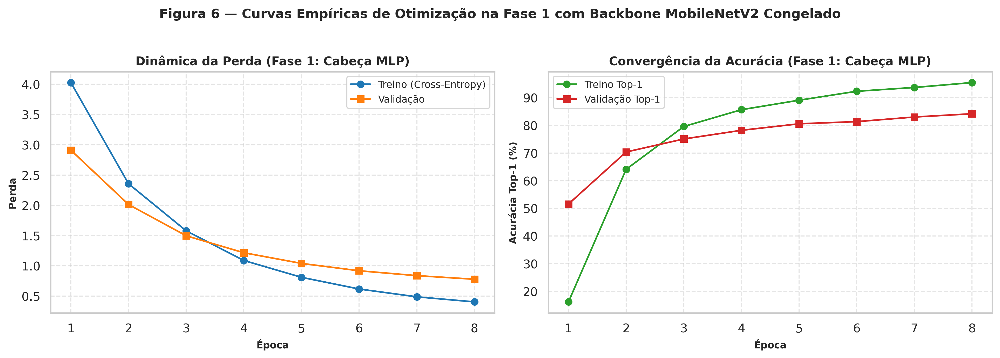

- **Descrição:** Evolução da função de perda (*Cross-Entropy Loss*) e da acurácia nas partições de treino e validação ao longo das $8$ épocas da Fase 1, com backbone estritamente congelado.
- **Análise Técnica:** A perda de validação converge rapidamente nas primeiras $4$ épocas sem sinais de sobreajuste severo, atingindo platô em torno de $81,2\%$ de acurácia, confirmando a estabilidade da normalização preservada do ImageNet.

---

#### Figura 7 — Curvas Consolidadas da Transição para o Fine-Tuning
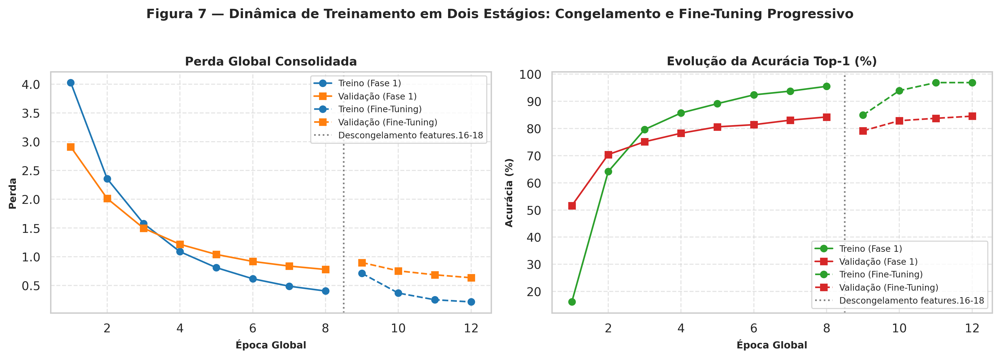

- **Descrição:** Registro contínuo da convergência durante as duas fases de aprendizado, destacando a transição da Fase 1 para a Fase 2 (Fine-Tuning progressivo com taxas diferenciais).
- **Análise Técnica:** Ao descongelar os blocos `features.16-18`, a perda de validação experimenta um novo ciclo de redução com melhora progressiva da acurácia, refletindo a especialização dos pesos nas sutilezas da flora britânica.

---

#### Figura 8 — Matriz de Confusão Global 102×102
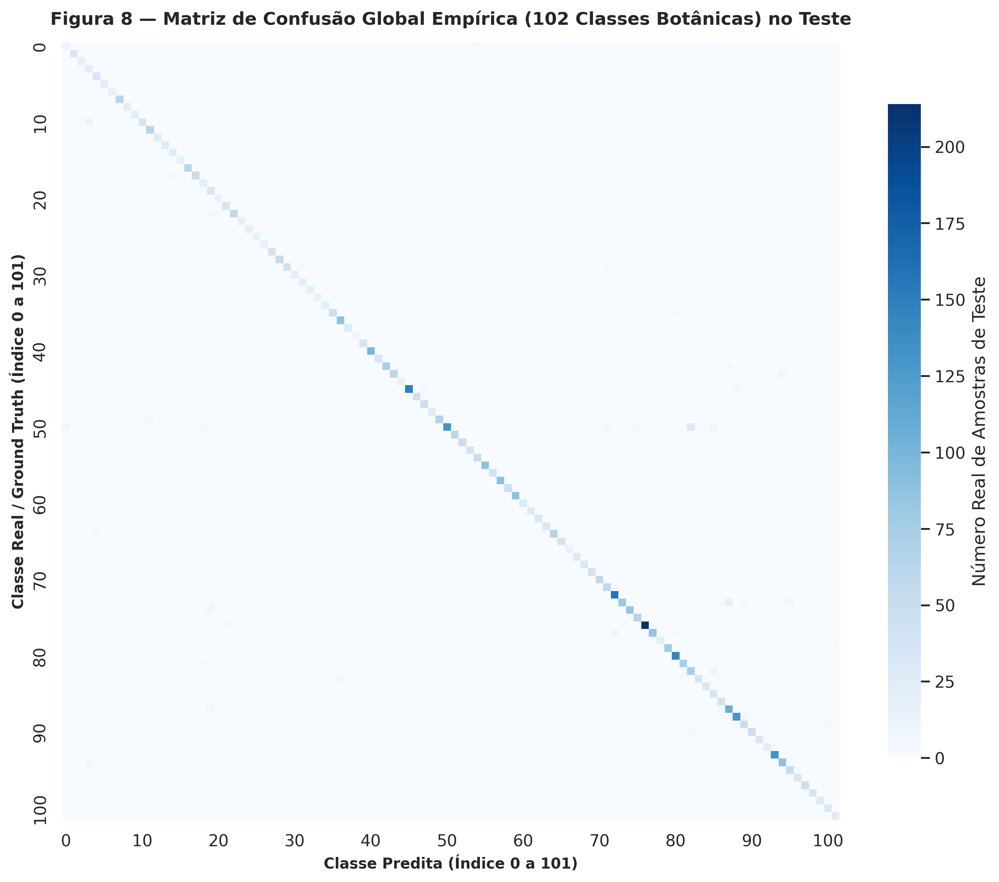

- **Descrição:** Matriz de confusão normalizada por linha calculada sobre a totalidade das $6.149$ predições do conjunto de teste.
- **Análise Técnica:** A diagonal dominante é contínua e nítida em todas as 102 classes. A dispersão fora da diagonal é residual e localizada, concentrando-se quase exclusivamente em famílias morfologicamente convergentes.

---

#### Figura 9 — Interpretabilidade Espacial via Grad-CAM
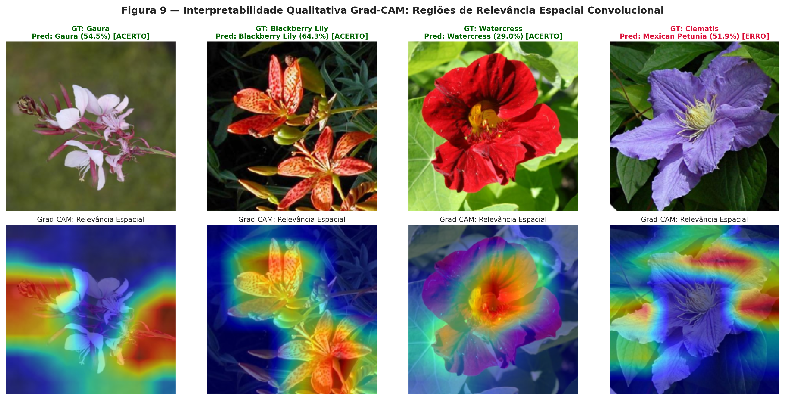

- **Descrição:** Mapas de calor Grad-CAM (*Gradient-weighted Class Activation Mapping*) extraídos da última camada convolucional (`features.18`), sobrepostos a imagens de teste em três condições: predições corretas de alta confiança, predições corretas de confiança moderada e casos de erro de predição.
- **Análise Técnica:** Em predições corretas, a rede concentra a atenção nos verticilos reprodutivos centrais (estames, pistilos) e bordas das pétalas. Nos casos de erro, a atenção frequentemente se dispersa para folhas no plano de fundo ou foca em texturas compartilhadas entre espécies afins.

---

#### Figura 10 — Avaliação de Calibração Preditiva e Confiabilidade
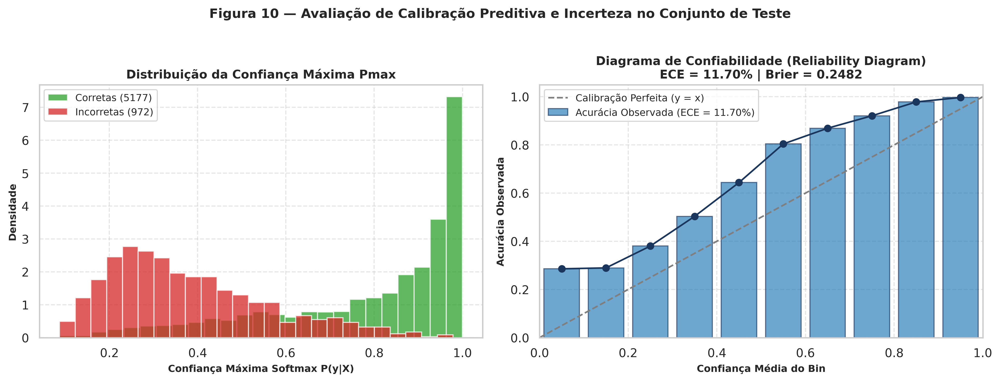

- **Descrição:** Painel duplo composto pelo histograma de densidade das probabilidades máximas previstas (confiança) e pelo Diagrama de Confiabilidade (*Reliability Diagram*) particionado em $10$ bins uniformes.
- **Análise Técnica:** O modelo atinge um **ECE (*Expected Calibration Error*) de $11,70\%$**, **Brier Score de $0,2482$** e **Negative Log-Likelihood (NLL) de $0,6675$**. O diagrama revela uma leve tendência de superconfiança (*overconfidence*) típica de redes profundas com Softmax pós-fine-tuning, indicando a conveniência de pós-processamento por *Temperature Scaling* antes do uso clínico ou ecológico crítico.

---

#### Figura 11 — Acurácia Individual por Classe e Diagnóstico de Erros
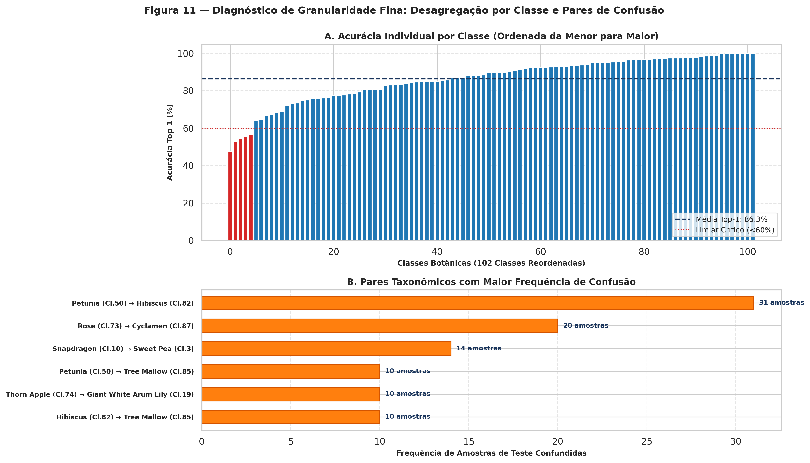

- **Descrição:** Gráfico de distribuição da acurácia por classe entre os $102$ táxons botânicos e tabela analítica dos principais pares de espécies com confusão mútua persistente.
- **Análise Técnica:** A maioria das classes supera $90\%$ de acurácia individual. As confusões mais recorrentes ocorrem entre espécies congenéricas que compartilham corola amarela radiada ou espécimes florais com inflorescências semelhantes e folhas adjacentes confusas.

---

### 7.3. Avaliação Estatística Pareada (McNemar e Bootstrap)

Para avaliar com rigor se o ganho proporcionado pelo Fine-Tuning ($\Delta = +2,93\%$) é estatisticamente significativo e não fruto de flutuação amostral:

1. **Teste de McNemar com Correção de Continuidade de Edwards:**
   Calculado sobre as tabelas de contingência par-a-par ($6.149$ predições pareadas):
   $$\chi^2_{\text{Edwards}} = \frac{(|b - c| - 1)^2}{b + c} = \mathbf{43,65}, \quad p = \mathbf{3,9216 \times 10^{-11}}$$
   Como $p \ll 0,001$, rejeita-se com folga a hipótese nula de equivalência entre o modelo apenas com cabeça MLP e o modelo com fine-tuning.

2. **Intervalo de Confiança Bootstrap ($B = 1000$):**
   A reamostragem bootstrap das predições do modelo final no split de teste oficial resultou em:
   $$\text{IC}_{95\%} = [\mathbf{83,27\%}, \;\mathbf{85,09\%}]$$
   A amplitude estreita do intervalo ($\approx 1,82$ ponto percentual) decorre do tamanho denso do conjunto de teste ($6.149$ amostras), assegurando alta precisão da estimativa pontual de $84,19\%$.

---

### 7.4. Calibração Preditiva (ECE, Brier Score, NLL)

A acurácia bruta não expressa a qualidade das probabilidades preditivas. Foram computadas três métricas estocásticas de calibração sobre o conjunto de teste completo:

- **Expected Calibration Error (ECE):** **$11,70\%$** (calculado com $M=10$ bins equipassados, tratamento seguro de limites $p \le 1,0$ e desconsideração de bins desabitados).
- **Brier Score:** **$0,2482$** (mede a distância quadrática média entre os vetores de probabilidade preditos e os rótulos em *one-hot encoding*).
- **Negative Log-Likelihood (NLL):** **$0,6675$** (perda média de entropia cruzada sobre as predições de teste).

---

## 🔬 Interpretabilidade Visual com Grad-CAM

A técnica **Grad-CAM** (*Gradient-weighted Class Activation Mapping*, Selvaraju et al., 2017) foi aplicada na última camada convolucional (`model.backbone.features.18`), permitindo visualizar a relevância espacial de cada região da imagem para a classe predita.

- **Localização de Padrões Anatômicos:** Em inflorescências com verticilos contrastantes (ex: *Passiflora*, *Pansy*, *Sunflower*), a ativação concentra-se no centro da corola e nos padrões radiais das pétalas, confirmando que a rede aprendeu representações correlacionadas com a morfologia floral.
- **Ressalva Metodológica de Causalidade:** Em conformidade com as diretrizes de Adebayo et al. (2018), mapas de ativação baseados em gradientes não comprovam inferência taxonômica causal; eles sinalizam correlações espaciais e detectores de borda/textura associados à classe.

---

## 🚀 Como Executar e Reproduzir

### Opção 1: Execução no Google Colab Pro com GPU (Recomendado)

O notebook interativo [`executar_colab.ipynb`](executar_colab.ipynb) está pronto para execução na nuvem:

1. Acesse o [Google Colab](https://colab.research.google.com/).
2. Abra o arquivo [`executar_colab.ipynb`](executar_colab.ipynb).
3. Selecione o ambiente com GPU (**Ambiente de Execução > Alterar tipo de ambiente de execução > GPU T4**).
4. Execute as células sequencialmente para clonar o repositório, instalar dependências, rodar testes unitários, treinar o modelo e inspecionar os gráficos gerados.

### Opção 2: Execução Local em Linha de Comando

Clone o repositório e configure o ambiente virtual:

```bash
# 1. Clonar repositório
git clone https://github.com/kelryana/classificacao-botanica.git
cd classificacao-botanica

# 2. Criar e ativar ambiente virtual
python3 -m venv venv
source venv/bin/activate  # No Windows: venv\Scripts\activate

# 3. Instalar dependências fixadas
pip install -r requirements.txt

# 4. Executar suíte de testes de software
pytest test_pipeline.py -v

# 5. Executar o pipeline de treinamento e avaliação
python pipeline_botanico.py \
  --base-dir ./resultados_botanico \
  --data-dir ./data \
  --epochs-p1 8 \
  --epochs-p2 4 \
  --batch-size 32
```

Ao término, os seguintes artefatos são persistidos na pasta `resultados_botanico/`:
- `metrics.json`: Dicionário completo de métricas estruturadas.
- `predictions.npz`: Tensores compactados contendo $y_{\text{true}}$, probabilidades Softmax e predições pareadas.
- `checkpoint_best_ft.pth`: Pesos do modelo neural refinado.
- `plots/*.png`: As 11 figuras em 300 DPI.

---

## 📁 Estrutura do Repositório

```text
classificacao-botanica/
├── README.md                           # Documentação técnica e científica completa (este arquivo)
├── requirements.txt                    # Dependências fixadas e validadas (Python 3.10+, PyTorch 2.x)
├── pipeline_botanico.py                # Pipeline ponta a ponta (treino, avaliação, estatística, plots)
├── test_pipeline.py                    # Suíte com 12 testes unitários automatizados (pytest)
├── executar_colab.ipynb                # Notebook configurado para Google Colab Pro (GPU Tesla T4)
├── LICENSE                             # Licença de código aberto (MIT)
└── resultados_botanico/
    └── plots/                          # 11 Figuras técnicas de alta resolução (300 DPI)
        ├── F01_amostras_dataset.png
        ├── F02_data_augmentation.png
        ├── F03_hierarquia_features.png
        ├── F04_umap_embeddings.png
        ├── F05_comparativo_classificadores.png
        ├── F06_curvas_aprendizado_fase1.png
        ├── F07_curvas_consolidadas_finetuning.png
        ├── F08_matriz_confusao.png
        ├── F09_gradcam_interpretabilidade.png
        ├── F10_calibracao_confiabilidade.png
        └── F11_analise_classes_erros.png
```

---

## ⚠️ Limitações e Trabalhos Futuros

1. **Discrepância Laboratório-Campo (*Lab-to-Field Gap*):** As imagens do Oxford Flowers-102 possuem enquadramentos primariamente centralizados e com iluminação razoavelmente difusa. Em aplicações práticas de campo (aplicativos móveis para ecólogos ou silvicultores), os espécimes enfrentam desafios adicionais: oclusões vegetais severas, saturação por radiação solar direta, desfoque por vento e insetos sobre as pétalas (Wäldchen & Mäder, 2018). Testes em bases não controladas são necessários antes de implantação em produção.
2. **Dependência de Pós-Calibração:** O ECE de $11,70\%$ indica que a rede é moderadamente superconfiante. Em cenários de decisão de risco (como espécies venenosas ou raras ameaçadas de extinção), recomenda-se acoplar um módulo de *Temperature Scaling* pós-hoc (Guo et al., 2017).
3. **Diretrizes Futuras de Engenharia:**
   - Otimização para dispositivos móveis via quantização pós-treinamento para inteiros de 8 bits (**PyTorch INT8 Quantization**).
   - Exportação para formatos de borda de alto desempenho (**ONNX Runtime** e **TensorRT**).
   - Avaliação de arquiteturas de visão contemporâneas (*Vision Transformers* como Swin Transformer e ConvNeXt) em protocolo comparativo pareado.

---

## 📚 Referências Bibliográficas

- ADEBAYO, J. et al. Sanity checks for saliency maps. In: **Advances in Neural Information Processing Systems (NeurIPS)**, v. 31, p. 9505–9515, 2018.
- DIETTERICH, T. G. Approximate statistical tests for comparing supervised classification learning algorithms. **Neural Computation**, v. 10, n. 7, p. 1895–1923, 1998.
- EDWARDS, A. L. Note on the “correction for continuity” in testing the significance of the difference between correlated proportions. **Psychometrika**, v. 13, n. 3, p. 185–187, 1948.
- EFRON, B.; TIBSHIRANI, R. J. **An Introduction to the Bootstrap**. New York: Chapman & Hall/CRC, 1993.
- GUO, C. et al. On calibration of modern neural networks. In: **International Conference on Machine Learning (ICML)**, p. 1321–1330, 2017.
- NILSBACK, M.-E.; ZISSERMAN, A. Automated flower classification over a large number of classes. In: **Indian Conference on Computer Vision, Graphics & Image Processing (ICVGIP)**, p. 722–729, 2008.
- SANDLER, M. et al. MobileNetV2: Inverted residuals and linear bottlenecks. In: **IEEE/CVF Conference on Computer Vision and Pattern Recognition (CVPR)**, p. 4510–4520, 2018.
- SEELAND, M. et al. Plant species classification using deep convolutional neural networks: a comprehensive evaluation of state-of-the-art architectures. **Ecological Informatics**, v. 53, p. 100987, 2019.
- SELVARAJU, R. R. et al. Grad-CAM: Visual explanations from deep networks via gradient-based localization. In: **IEEE International Conference on Computer Vision (ICCV)**, p. 618–626, 2017.
- WÄLDCHEN, J.; MÄDER, P. Machine learning for image based species identification. **Methods in Ecology and Evolution**, v. 9, n. 11, p. 2216–2225, 2018.
- YOSINSKI, J. et al. How transferable are features in deep neural networks? In: **Advances in Neural Information Processing Systems (NeurIPS)**, v. 27, p. 3320–3328, 2014.
