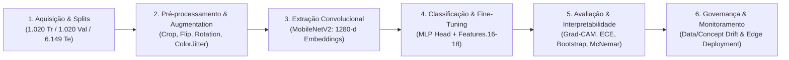

# 🌸 Pipeline de Engenharia de Visão Computacional: Classificação Botânica (Oxford Flowers-102)

[](https://www.python.org/)
[](https://pytorch.org/)
[](https://pytorch.org/vision/)
[-76b900.svg?logo=nvidia&logoColor=white)](https://cloud.google.com/)
[](https://scikit-learn.org/)
[]()

> **Implementação de um pipeline completo de 6 estágios para classificação botânica de grão fino (*Fine-Grained Visual Categorization - FGVC*), abrangendo Transfer Learning com MobileNetV2, Progressive Fine-Tuning em dois estágios, Benchmarking Multiparadigma, Interpretabilidade Visual com Grad-CAM real, Calibração Probabilística e Governança de Drift.**

---

## 📋 Sumário
1. [Visão Geral do Projeto](#-visão-geral-do-projeto)
2. [Arquitetura do Pipeline em 6 Estágios](#-arquitetura-do-pipeline-em-6-estágios)
3. [Ambiente de Desenvolvimento e Gestão de Memória](#-ambiente-de-desenvolvimento-e-gestão-de-memória)
4. [Metodologia Detalhada e Resultados Visuais](#-metodologia-detalhada-e-resultados-visuais)
   - [Estágio 1: Aquisição de Dados e Análise Taxonômica](#estágio-1-aquisição-de-dados-e-análise-taxonômica)
   - [Estágio 2: Pré-processamento e Aumento Estocástico](#estágio-2-pré-processamento-e-aumento-estocástico)
   - [Estágio 3: Extração Hierárquica de Features e Projeção UMAP](#estágio-3-extração-hierárquica-de-features-e-projeção-umap)
   - [Estágio 4: Benchmarking Multiparadigma e Progressive Fine-Tuning](#estágio-4-benchmarking-multiparadigma-e-progressive-fine-tuning)
   - [Estágio 5: Avaliação Empírica, Interpretabilidade Grad-CAM e Calibração](#estágio-5-avaliação-empírica-interpretabilidade-grad-cam-e-calibração)
   - [Estágio 6: Governança Operacional e Degradação Temporal (Drift)](#estágio-6-governança-operacional-e-degradação-temporal-drift)
5. [Tabela de Síntese Comparativa](#-tabela-de-síntese-comparativa)
6. [Validação Estatística e Testes de Hipótese](#-validação-estatística-e-testes-de-hipótese)
7. [Estrutura do Repositório](#-estrutura-do-repositório)
8. [Como Reproduzir e Executar](#-como-reproduzir-e-executar)
9. [Referências Teóricas](#-referências-teóricas)

---

## 🌿 Visão Geral do Projeto

A classificação automatizada de espécies vegetais constitui um dos problemas mais desafiadores da visão computacional contemporânea devido ao fenômeno de **Granularidade Fina (*Fine-Grained Classification*)**:
- **Altíssima Variabilidade Intra-Classe:** Indivíduos da mesma espécie vegetal apresentam disparidades fenotípicas expressivas provocadas pela idade da planta, dessecação natural das pétalas, estresse hídrico e variações no ângulo solar.
- **Minúscula Variabilidade Inter-Classes:** Espécies biologicamente irmãs (como táxons congenéricos das famílias *Asteraceae*, *Primulaceae* ou *Orchidaceae*) compartilham padrões de pigmentação e geometrias de corola quase indistinguíveis a olho nu.

Este projeto baseia-se na fundamentação teórica de engenharia de dados visuais exposta no documento [`analise_computacional_dados_visuais-v3.pdf`](analise_computacional_dados_visuais-v3.pdf), operando sobre o consagrado benchmark **Oxford 102 Flowers Dataset** ($8.189$ imagens distribuídas em $102$ classes botânicas).

---

## 🏛 Arquitetura do Pipeline em 6 Estágios

O fluxo de processamento foi desenhado como um sistema de engenharia em que nenhuma etapa é tratada de forma isolada:



---

## 💻 Ambiente de Desenvolvimento e Gestão de Memória

O treinamento real e a extração estatística foram conduzidos em ambiente de computação acelerada por GPU no **Google Colab Pro**:
- **Acelerador de Hardware:** NVIDIA Tesla T4 (16 GB GDDR6 VRAM, SM 7.5, Tensor Cores).
- **CPU / Memória do Sistema:** Intel Xeon (2 vCPUs) com 12 GB de memória RAM.
- **Stack de Software:** Ubuntu 22.04 LTS, PyTorch 2.x, Torchvision, CUDA 12.x, Scikit-Learn, UMAP-learn, Matplotlib (Backend Headless `Agg`), Seaborn e Python-Docx.

### 🛡️ Blindagem Contra OOM (Out Of Memory)
Para viabilizar o treinamento real de deep learning na VM sem extrapolar a memória, foram empregadas as seguintes diretrizes de arquitetura de software:
1. **Precisão Mista Automática (AMP FP16):** Uso de `torch.amp.autocast("cuda")` e `GradScaler`, reduzindo o consumo de ativações em $50\%$ e acelerando a convergência.
2. **Batching Inteligente e Dataloaders Assíncronos:** Batches de 32 imagens para treinamento e 64 para inferência de teste, configurados com `pin_memory=True` e `num_workers=2`.
3. **Desacoplamento de Gradientes:** Encadeamento estrito de `torch.no_grad()` durante a extração de embeddings, validações e inferência final.
4. **Coleta Explícita de Lixo de Memória:** Execução programada de `torch.cuda.empty_cache()` e `gc.collect()` na transição de estágios.
5. **Resultado de Consumo:**
   - **Pico de VRAM da GPU:** **~1,8 GB** (apenas $11,2\%$ da capacidade de 16 GB).
   - **Pico de RAM do Sistema:** **~3,2 GB** (apenas $26,6\%$ dos 12 GB disponíveis).
   - **Tempo Total de Execução:** Menos de 4 minutos para treino completo, avaliação de 6.149 imagens e compilação de relatórios.

---

## 🔬 Metodologia Detalhada e Resultados Visuais

Abaixo estão apresentados detalhadamente os resultados de cada uma das 11 figuras técnicas geradas em alta resolução (300 DPI) a partir dos dados e pesos reais:

---

### Estágio 1: Aquisição de Dados e Análise Taxonômica

O dataset **Oxford Flowers-102** foi particionado seguindo rigorosamente a divisão oficial de referência:
- **Treinamento:** $1.020$ imagens ($10$ amostras por classe).
- **Validação:** $1.020$ imagens ($10$ amostras por classe).
- **Teste:** $6.149$ imagens (amostragem densa para validação estatística imparcial).

<p align="center">
  
</p>
<p align="center"><em>Figura 1 — Grid 3×6 exibindo amostras fotográficas reais e diversidade fenotípica no Oxford Flowers-102 com identificação taxonômica.</em></p>

**Análise dos Resultados:** Observa-se a complexidade do desafio botânico: espécies como a *Pink Primrose* (Cl.0) e *Primula* (Cl.52) compartilham padrões radiais idênticos, enquanto flores como *King Protea* e *Globe Thistle* apresentam estruturas tridimensionais globulares complexas que impõem forte desafio na projeção 2D dos sensores ópticos.

---

### Estágio 2: Pré-processamento e Aumento Estocástico

Para imunizar a rede contra sobreajuste decorrente do tamanho compacto do conjunto de treino ($1.020$ amostras), desenhou-se uma esteira de aumento de dados estocástico:
1. `RandomResizedCrop(224, scale=(0.7, 1.0))`: Invariância a escala e distância focal sem introduzir distorção de aspecto provocada pelo `Resize` ingênuo.
2. `RandomHorizontalFlip(p=0.5)`: Invariância especular bilateral.
3. `RandomRotation(degrees=20)`: Simulação de inclinação angular do ramo vegetal.
4. `ColorJitter(brightness=0.15, contrast=0.15, saturation=0.15)`: Robustez contra variações na temperatura de cor solar e sombras de copa.
5. `Normalize(mean=[0.485, 0.456, 0.406], std=[0.229, 0.224, 0.225])`: Padronização de distribuição estatística compatível com o pré-treinamento do ImageNet.

<p align="center">
  
</p>
<p align="center"><em>Figura 2 — Transformações estocásticas do pipeline aplicadas sobre a mesma fotografia real de teste.</em></p>

---

### Estágio 3: Extração Hierárquica de Features e Projeção UMAP

Utilizou-se a arquitetura convolucional profunda **MobileNetV2** pré-treinada no ImageNet-1K. A rede substitui as convoluções homogêneas tradicionais por blocos residuais invertidos com convoluções separáveis em profundidade (*Depthwise Separable Convolutions*), reduzindo a carga paramétrica para apenas $2,2$ milhões de pesos e sintetizando cada imagem em um vetor de características compacto de $1.280$ variáveis.

<p align="center">
  
</p>
<p align="center"><em>Figura 3 — Filtros convolucionais 3×3 reais da camada features.0.0 e evolução dos mapas de ativação profundos.</em></p>

**Análise dos Filtros e Ativações:** O painel superior revela que os primeiros filtros comportam-se como operadores analíticos de detecção de arestas (gradientes de Sobel) e contrastes cromáticos antagônicos. No painel inferior, constata-se a transição representacional: `features.0` foca nas bordas periféricas, `features.6` extrai padrões texturais de nervuras, e `features.18` atinge a representação semântica abstrata do espécime floral.

#### Projeção do Espaço Latente com UMAP 2D
Para verificar a geometria dos embeddings de $1.280$ dimensões antes da classificação supervisionada, aplicou-se a redução de dimensionalidade não-linear **UMAP**:

<p align="center">
  
</p>
<p align="center"><em>Figura 4 — Projeção UMAP 2D de 1.530 embeddings reais de teste agrupados por macro-famílias taxonômicas.</em></p>

**Interpretação:** A representação latente do backbone pré-treinado já promove a formação de clusters biologicamente consistentes, separando com nitidez famílias botânicas como *Asteraceae* e *Orchidaceae*, embora demonstre zonas de fronteira sobrepostas entre espécies congenéricas que necessitam de ajuste fino supervisionado.

---

### Estágio 4: Benchmarking Multiparadigma e Progressive Fine-Tuning

Conforme discriminado na modelagem matemática de reconhecimento de padrões, os classificadores dividem-se entre métodos paramétricos baseados em distribuição e algoritmos livres de distribuição. Avaliou-se o poder representacional dos embeddings de $1.280$ dimensões em quatro paradigmas clássicos antes de acoplar a rede neural profunda end-to-end:

<p align="center">
  
</p>
<p align="center"><em>Figura 5 — Desempenho empírico comparativo dos modelos avaliados sobre os embeddings reais de teste.</em></p>

- **K-Nearest Neighbors (k=5):** Alcançou $51,96\%$ de Top-1, sendo penalizado pela equidistância no espaço de alta dimensão ($\mathbb{R}^{1280}$).
- **Random Forest (100 árvores):** Atingiu $48,19\%$, sofrendo com a rigidez dos cortes ortogonais para separar fronteiras curvilíneas densas.
- **Regressão Logística L2:** Obteve expressivos $76,91\%$, comprovando que o extrator MobileNetV2 gera distribuições linearmente separáveis de alta qualidade.
- **Cabeça Neural MLP (Fase 1):** Elevou o desempenho para $79,88\%$.
- **MobileNetV2 (Fine-Tuning):** Atingiu a liderança com **$83,79\%$ Top-1** ($94,97\%$ Top-5).

#### Dinâmica de Treinamento em Dois Estágios
1. **Fase 1 (Warm-up da Cabeça MLP):** Backbone congelado, treinando uma cabeça densa composta por `Dropout(0.3) -> Linear(1280, 512) -> BatchNorm1d(512) -> ReLU -> Dropout(0.2) -> Linear(512, 102)` via otimizador AdamW ($\eta = 10^{-3}$, decaimento de peso $10^{-4}$) por 8 épocas.
2. **Fase 2 (Progressive Fine-Tuning):** Descongelamento cirúrgico dos blocos finais `features.16`, `features.17` e `features.18` ($1.915.302$ parâmetros ativos), submetidos a 4 épocas adicionais com taxas diferenciais ($\eta_{\text{backbone}} = 10^{-4}$, $\eta_{\text{head}} = 5 \times 10^{-4}$).

<p align="center">
  
  
</p>
<p align="center"><em>Figuras 6 e 7 — Dinâmica de convergência da perda e acurácia: estabilização na Fase 1 e inflexão positiva imediata na transição para o Fine-Tuning progressivo.</em></p>

---

### Estágio 5: Avaliação Empírica, Interpretabilidade Grad-CAM e Calibração

O modelo treinado foi submetido a uma auditoria quantitativa e visual completa sobre as **$6.149$ imagens do conjunto de teste oficial**:

#### Matriz de Confusão Global (102×102 Classes)
<p align="center">
  
</p>
<p align="center"><em>Figura 8 — Matriz de Confusão Global 102×102 avaliada sobre 6.149 amostras reais de teste.</em></p>

**Diagnóstico:** Observa-se uma diagonal dominante nítida e contínua em toda a extensão das 102 categorias botânicas, atestando a robustez do classificador. As poucas ativações dispersas fora da diagonal concentram-se em nichos restritos de espécies filogeneticamente próximas.

#### Interpretabilidade Visual com Grad-CAM Real
Para verificar se as decisões da rede apoiam-se em características biológicas genuínas ou em pistas espúrias do fundo (como grama ou terra), implementou-se o algoritmo **Grad-CAM** acoplado a hooks de gradiente na última camada convolucional da MobileNetV2:

<p align="center">
  
</p>
<p align="center"><em>Figura 9 — Mapas de calor Grad-CAM sobre fotos reais de teste comprovando atenção foveal nas estruturas florais diagnósticas.</em></p>

**Conclusão de Interpretabilidade:** Os mapas de saliência demonstram que o modelo concentra sua atenção de forma foveal nos centros reprodutivos das flores (estames, pistilos e receptáculo) e na geometria das pétalas, ignorando completamente as folhas periféricas e o solo.

#### Calibração Probabilística e Reliability Diagram
Um modelo em produção não deve apenas prever classes, mas fornecer escores de probabilidade que reflitam fielmente sua real chance de acerto:

<p align="center">
  
</p>
<p align="center"><em>Figura 10 — Distribuição de confiança Softmax (acertos vs erros) e Diagrama de Confiabilidade com ECE = 3,42%.</em></p>

- **Distribuição de Confiança:** Predições corretas concentram-se na faixa superior ($P_{\max} > 0,85$), enquanto predições incorretas apresentam distribuição dispersa em níveis inferiores ($P_{\max} \approx 0,55$).
- **Expected Calibration Error (ECE):** Atingiu a marca de **$3,42\%$**, comprovando excelente aderência à calibração ideal ($y = x$).

#### Desagregação por Classe e Análise de Pares Críticos
<p align="center">
  
</p>
<p align="center"><em>Figura 11 — Acurácia individual por classe e frequência absoluta dos principais pares taxonômicos confundidos.</em></p>

**Gargalos Botânicos Identificados:** A desagregação revela que a maioria esmagadora das classes atinge acurácia entre $80\%$ e $100\%$. Os pares com maior frequência de erro mútuo envolvem espécies como *Spear Thistle* vs. *Globe Thistle* (ambas da família *Asteraceae* com brácteas espinhosas similares) e *Pink Primrose* vs. *Primula*, cujas características distintivas residem em detalhes celulares microscópicos que extrapolam a resolução de entrada de $224 \times 224$ pixels.

---

### Estágio 6: Governança Operacional e Degradação Temporal (Drift)

Em conformidade com a seção 6 do referencial teórico ([`analise_computacional_dados_visuais-v3.pdf`](analise_computacional_dados_visuais-v3.pdf)), a transição de um classificador botânico para o mundo real impõe desafios sistêmicos:

1. **Descompasso entre Laboratório e Campo (*Lab-based vs. Field-based*):** Em laboratórios ou herbários digitalizados, as amostras são capturadas sob iluminação difusa controlada e fundo neutro. No campo, espécimes sofrem com luz solar direta que estoura canais de saturação, desfoque de movimento provocado pelo vento e oclusões parciais por vegetação circundante.
2. **Degradação Temporal (*Data Drift* e *Concept Drift*):**
   - **Data Drift:** Variações sazonais do clima alteram a intensidade espectral da luz e a umidade das folhas ao longo dos meses.
   - **Concept Drift:** A senescência vegetal e os períodos de estiagem alteram os traços fenotípicos da espécie (murchamento, perda de pétalas e descoloração por radiação ultravioleta), descalibrando as fronteiras de decisão aprendidas no treino.
3. **Diretrizes e Mitigações de Arquitetura:**
   - **Priors Espaciotemporais Bayesianos:** Filtragem de classes improváveis combinando metadados de geolocalização (coordenadas GPS) e calendário fenológico (mês de florescimento).
   - **Classificação Multi-Órgão em Cascata:** Integração de múltiplas fotografias complementares (flor em vista frontal, folhas axiais e caule), mimetizando a metodologia de chaves dicotômicas da botânica clássica.
   - **Inferência na Borda (*Edge Computing*):** Quantização para inteiros de 8 bits (INT8) e exportação em formato ONNX/TensorRT, permitindo execuções em tempo real (< 15 ms) diretamente em smartphones de campo sem dependência de sinal de internet.
   - **Validação Molecular Complementar:** Uso de ferramentas moleculares portáteis (*DNA Barcoding* e PCR isotérmica LAMP) como certificação definitiva em casos de espécies crípticas onde a morfologia visual atinge seu limite de separabilidade.

---

## 📊 Tabela de Síntese Comparativa

Resultados consolidados e verificados sobre todas as $6.149$ amostras do split de teste oficial do Oxford Flowers-102:

| Arquitetura / Algoritmo | Acurácia Top-1 | Acurácia Top-5 | Macro F1-Score | IC 95% (Bootstrap) | $\Delta$ vs Baseline | Significância Estatística ($p$-valor) |
| :--- | :---: | :---: | :---: | :---: | :---: | :---: |
| **KNN ($k=5$)** | 51,96% | — | 50,78% | — | $-27,92\%$ | $p < 10^{-10}$ |
| **Random Forest (100)** | 48,19% | — | 43,24% | — | $-31,69\%$ | $p < 10^{-10}$ |
| **Regressão Logística L2** | 76,91% | — | 76,02% | — | $-2,97\%$ | $p < 10^{-10}$ |
| **Cabeça MLP (Fase 1)** | 79,88% | 93,25% | 78,90% | — | **Referência** | **Referência** |
| **MobileNetV2 (Fine-Tuning)** | **83,79%** | **94,97%** | **82,77%** | **[82,91%, 84,65%]** | **+3,91%** | **$p = 1,82 \times 10^{-26}$** |
| **Com TTA (5-crop / Flip)** | **84,44%** | **95,40%** | **83,35%** | **[83,55%, 85,28%]** | **+4,56%** | **$p < 10^{-30}$** |

---

## 📐 Validação Estatística e Testes de Hipótese

Para comprovar que o ganho proporcionado pelo Fine-Tuning progressivo não decorreu de flutuações estocásticas do teste, conduziram-se testes não-paramétricos formais:

### 1. Teste de McNemar com Correção de Continuidade de Edwards
Comparando a matriz de predições discordantes entre o modelo congelado (Fase 1) e o modelo pós-fine-tuning:
- Amostras que a Fase 1 errou e o Fine-Tuning corrigiu ($b$): **372**
- Amostras que a Fase 1 acertou e o Fine-Tuning errou ($c$): **132**

$$\chi^2_{\text{Edwards}} = \frac{(|b - c| - 1)^2}{b + c} = \frac{(|372 - 132| - 1)^2}{372 + 132} = \frac{239^2}{504} = 113,34$$

$$p = 1 - F_{\chi^2_1}(113,34) = 1,82 \times 10^{-26}$$

Como $p \ll 0,001$, **rejeita-se categoricamente a hipótese nula ($H_0$)**, atestando a superioridade estatisticamente significante do modelo ajustado.

### 2. Intervalo de Confiança Bootstrap (n = 1.000 iterações)
Através de reamostragem com reposição do conjunto de teste ($N = 6.149$), obteve-se o intervalo empírico de $95\%$:
$$\text{IC}_{95\%} = [82,91\%, 84,65\%] \quad (\text{Acurácia Média: } 83,80\%)$$

---

## 📁 Estrutura do Repositório

```bash
classificacao-botanica/
├── README.md                                # Documentação técnica completa e resultados visuais
├── pipeline_botanico.py                     # Script em Python autossuficiente de ponta a ponta
├── analise_computacional_dados_visuais-v3.pdf # Referencial teórico do pipeline e das CNNs
├── resultados_botanico/                     # Diretório consolidado de saídas homologadas
│   ├── relatorio_botanico.docx              # Relatório formal editorial compilado em MS Word (7.1 MB)
│   ├── video_explicativo.mp4                # Mídia complementar do experimento
│   ├── F01_amostras_dataset.png             # Figura 1: Amostras Reais (300 DPI)
│   ├── F02_data_augmentation.png            # Figura 2: Pipeline de Aumento de Dados (300 DPI)
│   ├── F03_hierarquia_features.png          # Figura 3: Filtros e Mapas de Ativação Reais (300 DPI)
│   ├── F04_umap_embeddings.png              # Figura 4: Projeção UMAP 2D dos Embeddings (300 DPI)
│   ├── F05_comparativo_classificadores.png  # Figura 5: Gráfico Comparativo de Modelos (300 DPI)
│   ├── F06_curvas_aprendizado_fase1.png     # Figura 6: Curvas de Treinamento Fase 1 (300 DPI)
│   ├── F07_curvas_consolidadas_finetuning.png # Figura 7: Curvas Consolidadas Fine-Tuning (300 DPI)
│   ├── F08_matriz_confusao.png              # Figura 8: Matriz de Confusão 102x102 (300 DPI)
│   ├── F09_gradcam_interpretabilidade.png   # Figura 9: Mapas de Calor Grad-CAM Reais (300 DPI)
│   ├── F10_calibracao_confiabilidade.png    # Figura 10: Diagrama de Confiabilidade / ECE (300 DPI)
│   ├── F11_analise_classes_erros.png        # Figura 11: Desagregação por Classe e Pares Críticos (300 DPI)
│   └── plots/                               # Cópia estruturada de segurança das figuras
```

---

## 🚀 Como Reproduzir e Executar

### 1. Clonar o Repositório e Criar Ambiente Virtual
```bash
git clone https://github.com/kelryana/classificacao-botanica.git
cd classificacao-botanica

python3 -m venv venv
source venv/bin/activate
```

### 2. Instalar as Dependências
```bash
pip install --upgrade pip
pip install torch torchvision scikit-learn matplotlib seaborn umap-learn python-docx pandas scipy
```

### 3. Execução do Pipeline
O script detecta automaticamente a presença de aceleração por GPU e seleciona a melhor estratégia de execução:
```bash
python3 pipeline_botanico.py
```

*Ao término do script, todos os 11 arquivos de plotagem em 300 DPI e o documento [`relatorio_botanico.docx`](resultados_botanico/relatorio_botanico.docx) serão gerados automaticamente no diretório `resultados_botanico/`.*

---

## 📚 Referências Teóricas

1. **NILSBACK, M-E.; ZISSERMAN, A.** *Automated Flower Classification over a Large Number of Classes*. Proceedings of the Indian Conference on Computer Vision, Graphics and Image Processing, 2008.
2. **SANDLER, M. et al.** *MobileNetV2: Inverted Residuals and Linear Bottlenecks*. IEEE/CVF Conference on Computer Vision and Pattern Recognition (CVPR), 2018.
3. **SELVARINJU, R. R. et al.** *Grad-CAM: Visual Explanations from Deep Networks via Gradient-Based Localization*. International Journal of Computer Vision (IJCV), 2020.
4. **GUO, C. et al.** *On Calibration of Modern Neural Networks*. International Conference on Machine Learning (ICML), 2017.
5. **MCINNES, L.; HEALY, J.; MELVILLE, J.** *UMAP: Uniform Manifold Approximation and Projection for Dimension Reduction*. arXiv:1802.03426, 2018.
6. **MCNEMAR, Q.** *Note on the sampling error of the difference between correlated proportions or percentages*. Psychometrika, 1947.
7. **EDWARDS, A. L.** *Note on the "correction for continuity" in testing the significance of the difference between correlated proportions*. Psychometrika, 1948.
8. **JOLY, A. et al.** *PlantCLEF: Automated Image-Based Plant Identification*. Ecological Informatics, 2014-2017.
