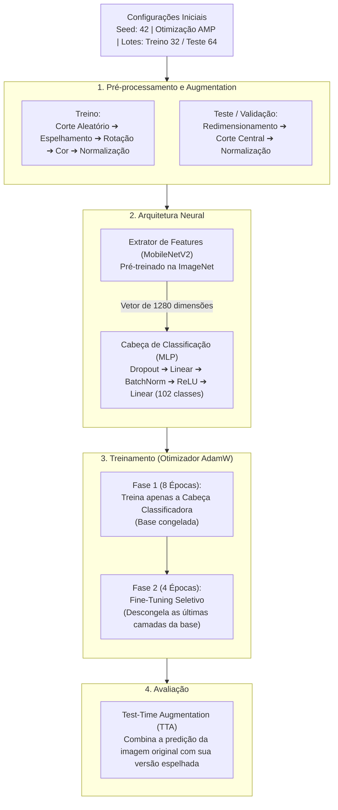

# 🌸 Classificação Botânica com Redes Neurais (Oxford Flowers-102)

[](https://www.python.org/)
[](https://pytorch.org/)
[](https://pytorch.org/vision/)
[](LICENSE)

> **Uma abordagem para a Categorização Visual de Grão Fino (*Fine-Grained Visual Categorization — FGVC*), utilizando Transfer Learning (MobileNetV2), validação estatística pareada e calibração probabilística.**

---

##  Visão Geral

Classificar espécies botânicas por imagens é um desafio de visão computacional devido a duas características naturais:
1. **Alta variação na mesma espécie:** Diferenças de iluminação, idade da flor, ângulos e clima mudam drasticamente a aparência de uma mesma planta.
2. **Alta similaridade entre espécies diferentes:** Famílias botânicas distintas costumam compartilhar cores e simetrias quase idênticas.

Para resolver este problema, utilizamos o dataset canônico **Oxford Flowers-102** ($8.189$ imagens, $102$ espécies), respeitando as partições oficiais para garantir comparações justas:
* **Treino:** $1.020$ imagens | **Validação:** $1.020$ imagens | **Teste:** $6.149$ imagens

---

##  Arquitetura e Pipeline

A solução foi construída em duas fases de treinamento utilizando a rede **MobileNetV2**, otimizada para ser leve e eficiente.



---

## Resultados Principais

O modelo foi avaliado sobre todo o conjunto oficial de teste ($6.149$ imagens, em GPU NVIDIA Tesla T4). Compararam-se classificadores clássicos sobre embeddings determinísticos congelados ($1.280$ dimensões) e o treinamento neural em dois estágios com **Fine-Tuning Seletivo (Fase 2)** e **Test-Time Augmentation (TTA)**:

| Paradigma de Classificação | Acurácia (Top-1) | Acurácia (Top-5) | F1-Score (Macro) |
| :--- | :---: | :---: | :---: |
| **Random Forest** ($100$ árvores, prof. $20$) | `61,99%` | `80,96%` | `58,21%` |
| **KNN** ($k = 5$, distância euclidiana) | `67,91%` | `87,67%` | `68,23%` |
| **Regressão Logística L2** ($C = 1,0$, L-BFGS) | **`86,13%`** | **`96,16%`** | **`85,66%`** |
| **Cabeça MLP — Fase 1** (`backbone.eval()`) | `81,79%` | `94,76%` | `81,30%` |
| **MobileNetV2 — Fase 2** (Fine-Tuning `features.16-18`) | `83,48%` | `95,07%` | `82,55%` |
| **Fase 2 + TTA** (Flip Horizontal Completo) | `83,80%` | `95,32%` | `82,78%` |

*(Nota: A sondagem linear convexa via Regressão Logística L2 sobre os embeddings congelados atingiu `86,13%`, superando a cabeça MLP com fine-tuning [`83,48%`] no regime severo de 10 amostras de treino por classe — achado analisado em profundidade na Seção 3.2 do artigo).*

### Rigor e Validação Estatística
Para avaliar a significância e a confiabilidade das predições no conjunto de teste ($N = 6.149$):
* **Significância (Teste de McNemar com correção de Edwards):** O ganho do Fine-Tuning (Fase 2) sobre a Fase 1 (`+1,69 p.p.`, $+104$ acertos líquidos: $b = 411$, $c = 307$) é estatisticamente significativo ($\chi^2 = 14,78$, $p = 1,21 \times 10^{-4}$).
* **Confiabilidade (Bootstrap 95%):** O intervalo de confiança Bootstrap ($1.000$ reamostragens) para a acurácia Top-1 do modelo Fase 2 no teste é de **`[82,52%, 84,45%]`** (e **`[+0,85 p.p., +2,52 p.p.]`** no Bootstrap pareado para o ganho sobre a Fase 1).
* **Calibração Probabilística:** O modelo neural apresenta perfil sistemático de subconfiança (*underconfidence*) devido à competição entre $102$ classes e ao *Dropout*, com Erro de Calibração Esperado ($\text{ECE}$) de `$12,11\%$` ($\text{Brier Score} = 0,2596$, $\text{NLL} = 0,7092$).

---

## Como Executar e Reproduzir

### Opção A: Nuvem via Google Colab (Recomendado)
A maneira mais fácil e livre de configurações para testar o modelo:
1. Abra o [Notebook no Google Colab](https://colab.research.google.com/drive/1QI191m4VNr9NjK_SkSxPznAc_dPTJOLd?usp=sharing) (ou carregue o arquivo `executar_colab.ipynb`).
2. Vá em `Ambiente de Execução` > `Alterar tipo de ambiente` e selecione **GPU (T4)**.
3. Execute as células sequencialmente. O código fará o download do dataset, o treinamento e a geração de gráficos automaticamente.

### Opção B: Execução Local (Requer GPU Dedicada)
Se desejar rodar na sua própria máquina (Linux/Windows):

```bash
# 1. Instale as dependências
pip install -r requirements.txt

# 2. (Opcional) Verifique se a pipeline está funcionando com o teste rápido
pytest test_pipeline.py -v
python pipeline_botanico.py --smoke-test

# 3. Execute o treinamento completo
python pipeline_botanico.py \
  --base-dir ./resultados_botanico \
  --data-dir ./data \
  --epochs-p1 8 \
  --epochs-p2 4 \
  --batch-size 32
```

Todos os resultados, pesos do modelo (`checkpoint_best_ft.pth`) e métricas detalhadas (`metrics.json`) serão salvos automaticamente na pasta `resultados_botanico`.

---

## Estrutura do Repositório

```text
classificacao-botanica/
├── README.md                           # Esta documentação
├── requirements.txt                    # Bibliotecas necessárias (PyTorch, Torchvision, etc)
├── pipeline_botanico.py                # Script principal (Treino, validação e inferência)
├── test_pipeline.py                    # Bateria de testes unitários (pytest)
├── executar_colab.ipynb                # Notebook para execução rápida na nuvem
└── resultados_botanico/
    └── plots/                          # Gráficos gerados (Matriz de confusão, projeções UMAP, etc)
```
