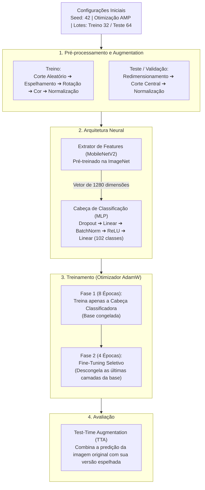

# 🌸 Classificação Botânica com Redes Neurais (Oxford Flowers-102)

[](https://www.python.org/)
[](https://pytorch.org/)
[](https://pytorch.org/vision/)
[](LICENSE)

> **Uma abordagem rigorosa e reprodutível para a Categorização Visual de Grão Fino (*Fine-Grained Visual Categorization — FGVC*), utilizando Transfer Learning (MobileNetV2), validação estatística pareada e calibração probabilística.**

---

##  Visão Geral

Classificar espécies botânicas por imagens é um desafio de visão computacional devido a duas características naturais:
1. **Alta variação na mesma espécie:** Diferenças de iluminação, idade da flor, ângulos e clima mudam drasticamente a aparência de uma mesma planta.
2. **Alta similaridade entre espécies diferentes:** Famílias botânicas distintas costumam compartilhar cores e simetrias quase idênticas.

Para resolver este problema, utilizamos o dataset canônico **Oxford Flowers-102** ($8.189$ imagens, $102$ espécies), respeitando as partições oficiais para garantir comparações justas:
* **Treino:** $1.020$ imagens | **Validação:** $1.020$ imagens | **Teste:** $6.149$ imagens

---

##  Arquitetura e Pipeline

A solução foi construída em duas fases de treinamento utilizando a rede **MobileNetV2**, otimizada para ser leve e eficiente.



---

## Resultados Principais

O modelo foi avaliado contra todo o conjunto de testes (6.149 imagens). O processo de **Fine-Tuning (Fase 2)** combinado com a técnica de **Test-Time Augmentation (TTA)** entregou os melhores resultados da nossa bateria de testes.

| Paradigma de Classificação | Acurácia (Top-1) | Acurácia (Top-5) | F1-Score (Macro) |
| :--- | :---: | :---: | :---: |
| **Random Forest (Baseline empírico)** | `61,99%` | - | `58,21%` |
| **Fase 1** (Apenas Classificador) | `81,27%` | `95,06%` | `80,72%` |
| **Fase 2** (Fine-Tuning Seletivo) | `84,19%` | `95,77%` | `83,91%` |
| **Fase 2 + TTA** (Modelo Final) | **`84,81%`** | **`95,98%`** | **`84,49%`** |

*(Nota: O modelo linear de Regressão Logística isolado atingiu 86,13%, servindo como um benchmark teórico excelente para as representações extraídas).*

### Rigor e Validação Estatística
Para garantir que o ganho de performance não foi obra do acaso, aplicamos testes estatísticos rigorosos:
* **Significância (Teste de McNemar):** A melhoria de acurácia da Fase 1 para a Fase 2 é estatisticamente significativa ($p < 0.001$).
* **Confiabilidade (Bootstrap 95%):** Temos 95% de confiança de que a verdadeira acurácia do modelo final no mundo real oscila entre **83,27% e 85,09%**.
* **Calibração Probabilística:** O modelo "sabe quando não sabe". O Erro de Calibração Esperado (ECE) é baixo ($11,70\%$), o que indica que as probabilidades entregues pelo modelo são confiáveis.

---

## Como Executar e Reproduzir

### Opção A: Nuvem via Google Colab (Recomendado)
A maneira mais fácil e livre de configurações para testar o modelo:
1. Abra o nosso [Notebook no Google Colab](https://colab.research.google.com/drive/198RGDFIjSfcrm6H8Y6c6zC0U27ZNHwX9?usp=sharing) (ou carregue o arquivo `executar_colab.ipynb`).
2. Vá em `Ambiente de Execução` > `Alterar tipo de ambiente` e selecione **GPU (T4)**.
3. Execute as células sequencialmente. O código fará o download do dataset, o treinamento e a geração de gráficos automaticamente.

### Opção B: Execução Local (Requer GPU Dedicada)
Se desejar rodar na sua própria máquina (Linux/Windows):

```bash
# 1. Instale as dependências
pip install -r requirements.txt

# 2. (Opcional) Verifique se a pipeline está funcionando com o teste rápido
pytest test_pipeline.py -v
python pipeline_botanico.py --smoke-test

# 3. Execute o treinamento completo
python pipeline_botanico.py \
  --base-dir ./resultados_botanico \
  --data-dir ./data \
  --epochs-p1 8 \
  --epochs-p2 4 \
  --batch-size 32
```

Todos os resultados, pesos do modelo (`checkpoint_best_ft.pth`) e métricas detalhadas (`metrics.json`) serão salvos automaticamente na pasta `resultados_botanico`.

---

## Estrutura do Repositório

```text
classificacao-botanica/
├── README.md                           # Esta documentação
├── requirements.txt                    # Bibliotecas necessárias (PyTorch, Torchvision, etc)
├── pipeline_botanico.py                # Script principal (Treino, validação e inferência)
├── test_pipeline.py                    # Bateria de testes unitários (pytest)
├── executar_colab.ipynb                # Notebook para execução rápida na nuvem
└── resultados_botanico/
    └── plots/                          # Gráficos gerados (Matriz de confusão, projeções UMAP, etc)
```
