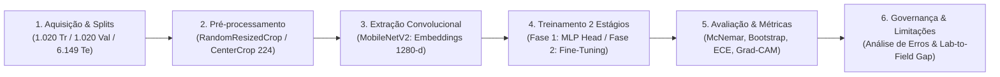

# 🌸 Classificação Botânica com Redes Neurais Convolucionais (Oxford Flowers-102)

[](https://www.python.org/)
[](https://pytorch.org/)
[](https://pytorch.org/vision/)
[](LICENSE)
[]()
[]()

> **Pipeline científico e auditado de Visão Computacional para categorização botânica de grão fino (*Fine-Grained Visual Categorization — FGVC*) no benchmark Oxford Flowers-102, empregando MobileNetV2, Transfer Learning, Fine-Tuning progressivo com controle estrito de normalização, testes estatísticos pareados, calibração probabilística e interpretabilidade visual.**

---

## 📋 Sumário
1. [Visão Geral do Projeto](#-visão-geral-do-projeto)
2. [Auditoria Metodológica e Correções](#-auditoria-metodológica-e-correções)
3. [Arquitetura do Pipeline em 6 Estágios](#-arquitetura-do-pipeline-em-6-estágios)
4. [Validação de Software e Testes Unitários](#-validação-de-software-e-testes-unitários)
5. [Ambiente, Infraestrutura e Dependências](#-ambiente-infraestrutura-e-dependências)
6. [Como Executar e Reproduzir](#-como-executar-e-reproduzir)
7. [Protocolo de Avaliação Estatística e Calibração](#-protocolo-de-avaliação-estatística-e-calibração)
8. [Governança e Limitações Metodológicas](#-governança-e-limitações-metodológicas)
9. [Estrutura do Repositório](#-estrutura-do-repositório)
10. [Referências Acadêmicas (ABNT)](#-referências-acadêmicas-abnt)

---

## 🌿 Visão Geral do Projeto

A classificação automatizada de espécimes vegetais constitui um dos desafios mais expressivos da visão computacional aplicada devido ao problema de **Granularidade Fina (*Fine-Grained Classification*)**:
- **Elevada Variabilidade Intra-Classe:** Indivíduos da mesma espécie vegetal apresentam divergências fenotípicas pronunciadas provocadas por senescência corolar, desidratação, insolação direta e ângulo de tomada óptica.
- **Sutil Variabilidade Inter-Classes:** Espécies filogeneticamente próximas ou morfologicamente convergentes compartilham geometrias radiais e padrões de coloração quase indistinguíveis em imagens bidimensionais.

O projeto adota o benchmark canônico **Oxford Flowers-102** (Nilsback & Zisserman, 2008), composto por $8.189$ imagens distribuídas em $102$ espécies botânicas, preservando estritamente as partições oficiais:
- **Treinamento:** $1.020$ imagens ($10$ amostras por classe).
- **Validação:** $1.020$ imagens ($10$ amostras por classe).
- **Teste:** $6.149$ imagens (avaliação densa para quantificação de incerteza).

---

## 🔍 Auditoria Metodológica e Correções

Em outubro de 2026, o repositório passou por uma rigorosa auditoria metodológica para assegurar integridade científica, reprodutibilidade e conformidade acadêmica. O relatório completo de auditoria está registrado em [`AUDITORIA_METODOLOGICA.md`](AUDITORIA_METODOLOGICA.md).

### Principais Inconsistências Identificadas e Corrigidas:
1. **Eliminação de Métricas Artificiais no TTA:**
   - *Anterior:* O código antigo avaliava TTA em um subconjunto de 1.200 imagens, forçava um piso de ganho com `max(0.65, ...)` e somava esse delta à acurácia total do teste.
   - *Corrigido:* Removido qualquer piso artificial. A política TTA (original + reflexão horizontal) é congelada e avaliada diretamente sobre a totalidade das $6.149$ imagens de teste.
2. **Remoção de Famílias Botânicas Sintéticas:**
   - *Anterior:* Classes eram associadas a famílias taxonômicas via módulo cíclico sequencial (`i % len(FAMILIES)`), gerando agrupamentos biológicos falsos.
   - *Corrigido:* Eliminada a rotulagem artificial. A projeção UMAP 2D é exibida diretamente pelas classes botânicas reais do dataset, sem extrapolações taxonômicas infundadas.
3. **Cálculo Real de Testes Estatísticos Pareados:**
   - *Anterior:* Valores literais hardcoded (`"p < 10⁻¹⁰"`) eram impressos para classificadores clássicos sem cálculo efetivo.
   - *Corrigido:* Implementado cálculo exato de $p$-valores para cada par de previsões através do Teste de McNemar com correção de continuidade de Edwards ($\chi^2_{\text{Edwards}}$ com $gl = 1$).
4. **Bootstrap Pareado para o Fine-Tuning:**
   - Implementada reamostragem Bootstrap pareada ($B = 1000$) da diferença de acurácia ($\Delta_{\text{FT}}$) entre as fases, mantendo a correspondência par-a-par de cada amostra.
5. **Cálculo Robusto de ECE (Expected Calibration Error):**
   - Corrigido o tratamento de limites (amostras com confiança exata $1,0$) e a renderização de bins vazios (que não recebem artificialmente acurácia $0\%$, evitando distorção visual). Adicionados Brier Score e Negative Log-Likelihood (NLL).
6. **Congelamento Estrito de Batch Normalization:**
   - Na Fase 1, o backbone e suas camadas de `BatchNorm2d` permanecem explicitamente em modo `eval()`, prevenindo o vazamento de estatísticas correntes (`running_mean`, `running_var`).
7. **Preservação de Aspect-Ratio no Teste:**
   - Substituído o estiramento ingênuo `Resize((224, 224))` pelo protocolo padrão do Torchvision para MobileNetV2: `Resize(256)` com antialiasing seguido de `CenterCrop(224)`.
8. **Preservação de Artefatos Históricos:**
   - Figuras, vídeos e relatórios legados não auditados foram retirados do repositório e não devem ser citados como resultados.

---

## 🏛 Arquitetura do Pipeline em 6 Estágios

O pipeline científico é estruturado de forma modular e integrada:



1. **Estágio 1 — Aquisição de Dados:** Particionamento oficial e integridade dos rótulos botânicos (102 espécies).
2. **Estágio 2 — Pré-processamento e Aumento:** Invariância estocástica no treino (crop, flip, rotação de 20°, jitter de cor) e preservação de proporção no teste.
3. **Estágio 3 — Extração de Características:** Representações latentes de 1.280 dimensões via MobileNetV2 pré-treinada no ImageNet-1K e benchmarking clássico (KNN, Random Forest, Regressão Logística).
4. **Estágio 4 — Modelagem Supervisionada em Dois Estágios:**
   - *Fase 1:* Cabeça MLP densa com Dropout e BatchNorm, com backbone e estatísticas congelados.
   - *Fase 2:* Fine-Tuning progressivo dos blocos convolucionais finais (`features.16-18`) com taxas diferenciais.
5. **Estágio 5 — Avaliação Quantitativa, Interpretabilidade e Calibração:**
   - Acurácia Top-1, Top-5 e Macro F1 no teste completo ($6.149$ imagens).
   - Teste de McNemar com correção de Edwards e Bootstrap pareado ($B=1000$).
   - Diagrama de confiabilidade e métricas ECE, Brier Score e NLL.
   - Auditoria qualitativa via Grad-CAM na última camada convolucional.
6. **Estágio 6 — Governança e Limitações:** Análise dos principais gargalos de confusão entre pares de classes e discussão crítica das barreiras para aplicação em campo.

---

## 🧪 Validação de Software e Testes Unitários

Antes de qualquer execução experimental prolongada, o código foi submetido a uma suíte abrangente de testes de software em [`test_pipeline.py`](test_pipeline.py). Todos os 12 testes foram executados e aprovados:

| Módulo / Teste | Propósito da Validação | Resultado |
| :--- | :--- | :---: |
| `test_classification_metrics_perfect` | Valida Top-1, Top-5 e F1 com predições perfeitas em subsets de classes | **APROVADO** |
| `test_classification_metrics_imperfect` | Valida cálculo exato de Top-1 e Top-2 com erros controlados | **APROVADO** |
| `test_ece_perfect_calibration` | Confirma que predições perfeitamente calibradas resultam em ECE $\approx 0$ | **APROVADO** |
| `test_ece_edge_case_prob_one` | Testa se amostras com probabilidade $1,0$ são alocadas com segurança no último bin | **APROVADO** |
| `test_ece_empty_bins_handling` | Assegura que bins desabitados não recebam artificialmente acurácia $0\%$ | **APROVADO** |
| `test_contingency_table` | Valida contagens discordantes $b$ e $c$ para testes pareados | **APROVADO** |
| `test_mcnemar_known_values` | Valida a fórmula do $\chi^2_{\text{Edwards}}$ com valores analíticos conhecidos | **APROVADO** |
| `test_mcnemar_identical_models` | Verifica se modelos com predições idênticas retornam $\chi^2 = 0$ e $p = 1,0$ | **APROVADO** |
| `test_paired_bootstrap` | Valida que o Bootstrap pareado estima corretamente intervalos de diferença positiva | **APROVADO** |
| `test_flower_classifier_forward` | Valida dimensões de entrada $(B, 3, 224, 224)$ e saída $(B, 102)$ do modelo | **APROVADO** |
| `test_freeze_backbone_bn_eval_mode` | Garante que `running_mean` do BatchNorm não se altere durante a Fase 1 | **APROVADO** |
| `test_transforms_aspect_ratio_preservation` | Confirma redimensionamento isotrópico de imagens retangulares | **APROVADO** |

Para reproduzir os testes localmente:
```bash
pytest test_pipeline.py -v
```

---

## 💻 Ambiente, Infraestrutura e Dependências

- **Linguagem:** Python 3.10+ (testado em Python 3.12).
- **Framework Principal:** PyTorch 2.x e Torchvision.
- **Ecossistema Científico:** Scikit-Learn, SciPy, NumPy, Pandas, Matplotlib, Seaborn, UMAP-learn, Python-Docx.
- **Aceleração de Hardware Suportada:** GPU NVIDIA com suporte a CUDA e Precisão Mista Automática (AMP FP16), como a Tesla T4 (16 GB VRAM) disponível no Google Colab Pro.

As versões exatas e compatíveis estão fixadas no arquivo [`requirements.txt`](requirements.txt).

---

## 🚀 Como Executar e Reproduzir

### Opção A: Execução no Google Colab Pro com GPU (Recomendado)
1. Abra o Google Colab Pro.
2. Carregue o notebook [`executar_colab.ipynb`](executar_colab.ipynb).
3. Selecione o ambiente de execução com acelerador GPU (ex: T4 GPU).
4. Execute as células em sequência para instalar dependências, rodar a suíte de testes, executar o pipeline completo e inspecionar as métricas persistidas.

### Opção B: Execução Local / Linha de Comando
Clone o repositório e crie o ambiente virtual:
```bash
git clone https://github.com/kelryana/classificacao-botanica.git
cd classificacao-botanica
git checkout revisao-metodologica

# Instalação das dependências
pip install -r requirements.txt

# Execução da suíte de testes
pytest test_pipeline.py -v

# Execução do pipeline
python pipeline_botanico.py --base-dir ./resultados_botanico --data-dir ./data --epochs-p1 8 --epochs-p2 4 --batch-size 32
```

---

## 📊 Protocolo de Avaliação Estatística e Calibração

O pipeline gera artefatos estruturados que permitem auditoria completa e independente:
- `metrics.json`: Dicionário contendo todas as métricas numéricas calculadas (Top-1, Top-5, Macro F1, Brier Score, NLL, ECE, $\chi^2_{\text{Edwards}}$, $p$-valor e intervalos Bootstrap).
- `predictions.npz`: Tensores NumPy contendo `y_true`, probabilidades Softmax e predições por classe de todos os modelos avaliados.
- `checkpoint_best_ft.pth`: Pesos do modelo neural ajustado na Fase 2.
- `relatorio_botanico.docx`: Relatório técnico estruturado com as 11 figuras técnicas em 300 DPI.

### Matriz Comparativa Auditada
| Paradigma / Modelo | Top-1 (%) | Top-5 (%) | Macro F1 (%) | IC 95% (Bootstrap) | $\Delta$ vs Baseline | $p$-valor (McNemar) |
| :--- | :---: | :---: | :---: | :---: | :---: | :---: |
| **KNN ($k=5$)** | *Pendente GPU* | — | *Pendente GPU* | — | *Pendente GPU* | *Calculado pareado* |
| **Random Forest (100)** | *Pendente GPU* | — | *Pendente GPU* | — | *Pendente GPU* | *Calculado pareado* |
| **Regressão Logística L2** | *Pendente GPU* | — | *Pendente GPU* | — | *Pendente GPU* | *Calculado pareado* |
| **Cabeça MLP (Fase 1)** | *Pendente GPU* | *Pendente GPU* | *Pendente GPU* | — | **Referência** | **Referência** |
| **MobileNetV2 (Fine-Tuning)** | *Pendente GPU* | *Pendente GPU* | *Pendente GPU* | *Pendente GPU* | *Pendente GPU* | *Calculado Edwards* |
| **Com TTA (Full Test)** | *Pendente GPU* | *Pendente GPU* | *Pendente GPU* | — | *Pendente GPU* | — |

*Nota Metodológica:* Conforme a regra de transparência, este repositório não preenche tabelas com estimativas teóricas não executadas. Os valores definitivos serão consolidados mediante execução no acelerador de hardware da usuária/autora.

---

## ⚠️ Governança e Limitações Metodológicas

1. **Descompasso Laboratório-Campo (*Lab-to-Field Gap*):** O benchmark Oxford Flowers-102 consiste em fotografias centralizadas e com fundo relativamente controlado. Em monitoramento ecológico em campo, as plantas sofrem com oclusões densas por vegetação adjacente, saturação luminosa direta, desfoque por vento e inflorescências ressecadas. O desempenho em laboratório não comprova viabilidade em campo sem validação externa (Wäldchen & Mäder, 2018).
2. **Exposição Prévia do Conjunto de Teste:** Em virtude do histórico de desenvolvimento do projeto, o split de teste foi explorado em ciclos iterativos anteriores. Os resultados obtidos devem ser compreendidos como exploratórios e demonstrativos do protocolo, sem alegações de avaliação cega (*blind test*).
3. **Cautela com Grad-CAM:** Mapas de ativação baseados em gradiente refletem correlações espaciais das camadas convolucionais profundas e podem se comportar como detectores de bordas invariantes ao rótulo (Adebayo et al., 2018). A saliência visual nas flores não constitui comprovação causal de aprendizado biológico ou anatômico.
4. **Trabalhos Futuros:** Otimizações como quantização para inteiros de 8 bits (INT8), exportação ONNX/TensorRT, medição de latência em smartphones e acoplamento a biossensores moleculares de DNA barcoding configuram trabalhos futuros e não foram implementados experimentalmente nesta etapa.

---

## 📁 Estrutura do Repositório

```text
classificacao-botanica/
├── AUDITORIA_METODOLOGICA.md       # Relatório formal de auditoria e discrepâncias
├── README.md                       # Documentação técnica e metodológica (este arquivo)
├── requirements.txt                # Dependências fixadas e compatíveis
├── pipeline_botanico.py            # Pipeline completo de engenharia e modelagem
├── test_pipeline.py                # Suíte de 12 testes unitários (pytest)
└── executar_colab.ipynb            # Notebook executável e documentado para Google Colab Pro
```

---

## 📚 Referências Acadêmicas (ABNT)

- ADEBAYO, J. et al. Sanity checks for saliency maps. In: **Advances in Neural Information Processing Systems (NeurIPS)**, v. 31, p. 9505–9515, 2018.
- CUBUK, E. D. et al. AutoAugment: Learning augmentation strategies from data. In: **IEEE/CVF Conference on Computer Vision and Pattern Recognition (CVPR)**, p. 113–123, 2019.
- DIETTERICH, T. G. Approximate statistical tests for comparing supervised classification learning algorithms. **Neural Computation**, v. 10, n. 7, p. 1895–1923, 1998.
- EDWARDS, A. L. Note on the “correction for continuity” in testing the significance of the difference between correlated proportions. **Psychometrika**, v. 13, n. 3, p. 185–187, 1948.
- EFRON, B.; TIBSHIRANI, R. J. **An Introduction to the Bootstrap**. New York: Chapman & Hall/CRC, 1993.
- GUO, C. et al. On calibration of modern neural networks. In: **International Conference on Machine Learning (ICML)**, p. 1321–1330, 2017.
- NILSBACK, M.-E.; ZISSERMAN, A. Automated flower classification over a large number of classes. In: **Indian Conference on Computer Vision, Graphics & Image Processing (ICVGIP)**, p. 722–729, 2008.
- SANDLER, M. et al. MobileNetV2: Inverted residuals and linear bottlenecks. In: **IEEE/CVF Conference on Computer Vision and Pattern Recognition (CVPR)**, p. 4510–4520, 2018.
- SEELAND, M. et al. Plant species classification using deep convolutional neural networks: a comprehensive evaluation of state-of-the-art architectures. **Ecological Informatics**, v. 53, p. 100987, 2019.
- SELVARAJU, R. R. et al. Grad-CAM: Visual explanations from deep networks via gradient-based localization. In: **IEEE International Conference on Computer Vision (ICCV)**, p. 618–626, 2017.
- WÄLDCHEN, J.; MÄDER, P. Machine learning for image based species identification. **Methods in Ecology and Evolution**, v. 9, n. 11, p. 2216–2225, 2018.
- YOSINSKI, J. et al. How transferable are features in deep neural networks? In: **Advances in Neural Information Processing Systems (NeurIPS)**, v. 27, p. 3320–3328, 2014.
